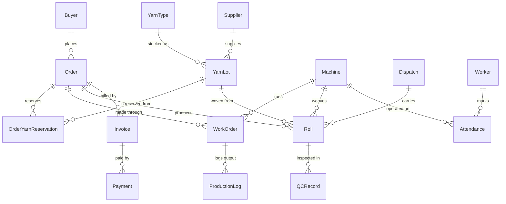

# ThreadLine architecture

This document explains how ThreadLine is put together and why: the runtime, the data model,
and the rules that keep money, stock and status correct when many people use the system at
once. For setup and a tour of the screens, see the [README](../README.md). For every API
route, see [API.md](API.md).

## Contents

1. [Runtime](#runtime)
2. [Request lifecycle and authorisation](#request-lifecycle-and-authorisation)
3. [Data model](#data-model)
4. [Database access](#database-access)
5. [Consistency under concurrency](#consistency-under-concurrency)
6. [Derived state: order status and alerts](#derived-state-order-status-and-alerts)
7. [Money: invoices, payments, the ledger and reversals](#money-invoices-payments-the-ledger-and-reversals)
8. [The costing engine](#the-costing-engine)
9. [Realtime](#realtime)
10. [Offline-first and the PWA](#offline-first-and-the-pwa)
11. [Alerts, the outbox and WhatsApp](#alerts-the-outbox-and-whatsapp)
12. [The AI query assistant](#the-ai-query-assistant)
13. [Front-end conventions](#front-end-conventions)
14. [Testing strategy](#testing-strategy)
15. [Key decisions](#key-decisions)

---

## Runtime

ThreadLine is a single **Node.js process** started by [`server.js`](../server.js):

```text
┌──────────────────────────── server.js (one HTTP server) ────────────────────────────┐
│  Next.js 16 request handler                     Socket.IO server (/api/socketio)    │
│  ├─ server-rendered pages (src/app)             ├─ session check on handshake       │
│  ├─ route handlers (src/app/api/**/route.ts)    └─ broadcast of domain events       │
│  └─ proxy.ts (route protection)                                                     │
│  Optional: alert-outbox drain every 15 s (ALERT_WORKER_TOKEN)                       │
└─────────────────────────────────────────────────────────────────────────────────────┘
                │ Prisma (pg driver adapter)
                ▼
        PostgreSQL (Supabase in production)
```

- **Why a custom server?** Socket.IO needs a long-lived HTTP server. `next dev` / `next start`
  do not provide one, so `npm run dev` and `npm run start` run `server.js`, which boots
  Next.js and attaches Socket.IO to the same server and port.
- **Next.js 16 specifics.** The App Router uses Cache Components; pages and layouts that read
  the session or query the database opt out of static rendering. Route protection lives in
  `src/proxy.ts` (Next 16 renamed `middleware.ts` to `proxy.ts`).
- **Deployment target.** Any host that runs a persistent Node process (Railway by default —
  see [`railway.json`](../railway.json)). Serverless platforms are unsuitable because of the
  persistent socket server.

## Request lifecycle and authorisation

1. **Sign-in** (`POST /api/auth/login`) checks the bcrypt password hash, creates a `Session`
   row holding the **SHA-256 hash** of a random 256-bit token, and sets the raw token in an
   HTTP-only cookie (`SameSite=Lax`, `Secure` in production, 7-day lifetime).
2. **Every request** resolves the user from the cookie (`getCurrentUser()` in
   `src/lib/auth.ts`, which deliberately loads only `id`, `name` and `role` — the profile row
   can carry a ~30 KB avatar).
3. **Every route handler** checks the role it needs before doing anything:
   `requireRole("owner", …)`, `productionActor()` (owner, floor supervisor) or
   `qualityActor(…)`. Pages do the same on the server and redirect to the role's home page.
   Hiding UI is never the only protection.
4. **Validation** — request bodies and query strings are parsed with Zod. Failures return
   **HTTP 400** with `{ "fieldErrors": { "<field>": ["message"] } }`, which forms render next
   to the right input. Business-rule refusals use **409** (conflict) or **400** with a
   specific field.
5. **Audit** — every write records an `AuditLog` row (entity, id, action, before/after, user).
6. **Realtime** — after the transaction commits, the route emits a domain event (see
   [Realtime](#realtime)).

Public routes are deliberately few: sign-in, the buyer tracking page and its API
(unguessable per-order token), `GET /api/health`, and the WhatsApp webhook (signature
verified).

## Data model

The Prisma schema ([`prisma/schema.prisma`](../prisma/schema.prisma)) has 28 models in six
groups:

| Group | Models | Notes |
|---|---|---|
| Identity | `User`, `Session` | Roles: `owner`, `storekeeper`, `floor_supervisor`, `qc_inspector`. Per-user preferences (JSON). |
| Orders & stock | `Buyer`, `Supplier`, `YarnType`, `YarnLot`, `Order`, `OrderYarnReservation`, `PurchaseRequest` | An order reserves kilograms from specific lots; low stock raises purchase requests. |
| Production | `Machine`, `WorkOrder`, `ProductionLog`, `MaintenanceRequest` | One work order per order per stage (spinning → weaving → dyeing); output logged per shift. |
| Quality & dispatch | `Roll`, `QCRecord`, `Dispatch`, `Invoice` | A roll links its order, machine, work order, yarn lot and (once shipped) dispatch. |
| Accounts | `Worker`, `Attendance`, `Expense`, `Payment`, `PayoutApproval`, `LedgerEntry`, `Reversal` | Money is append-only: corrections are reversals plus replacements. |
| Signals & history | `Notification`, `NotificationRead`, `AlertDelivery`, `AuditLog` | Read state is per user; buyer messages queue in the outbox. |



Schema changes are made **additively** through Prisma migrations
([`prisma/migrations`](../prisma/migrations)); existing fields are not repurposed.

## Database access

`src/lib/db.ts` creates a single Prisma client on top of a **node-postgres pool**
(`@prisma/adapter-pg`, Prisma's `driverAdapters` feature):

- Through Supabase's **transaction pooler** (port 6543) the built-in Prisma engine needs
  `pgbouncer=true`, which costs about five network round trips per query. node-postgres sends
  each query in **one** round trip and is safe on that pooler, which made typical requests
  3–4× faster.
- Prisma-only URL parameters (`pgbouncer`, `connection_limit`, …) are stripped before the
  URL reaches `pg`; `connection_limit` becomes the pool size. Connections to non-local hosts
  are encrypted.
- `DIRECT_URL` (session connection) is used only by `prisma migrate`.
- Scripts and `server.js`'s socket session check use the built-in engine with the same URL,
  which stays correct (`pgbouncer=true`) and is off the request hot path.

## Consistency under concurrency

The mill has several people writing at once — two storekeepers loading trucks, an inspector
re-submitting an offline queue, an owner double-clicking "Record payment". The rules:

- **Serialised write transactions.** `writeTransaction()` (`src/lib/concurrency.ts`) runs
  read-then-write work inside an interactive transaction, queued one at a time per process,
  and takes the write lock on its first statement. Hot paths additionally lock the rows they
  read (`SELECT … FOR UPDATE`).
- **Re-check inside the transaction.** Stock reservation re-reads remaining kilograms;
  dispatch re-checks that no selected roll already has a `dispatchId`; payment re-checks the
  outstanding balance after inserting — so two concurrent requests cannot oversell yarn,
  double-dispatch a roll or overpay an invoice.
- **Retries for collisions.** `withRetry()` retries unique-number races (invoice numbers
  `INV-YYMM-NNNN`, roll numbers) and transient write conflicts.
- **Idempotency keys.** Payments, QC inspections and dispatches accept a client-generated
  `clientMutationId`; a repeated request returns the result already recorded instead of
  writing twice. This is what makes offline replay and double-clicks safe.
- **Short transactions.** Follow-up work (audit, alerts, realtime) runs after commit, and a
  failure there never turns a committed write into a 500 that invites a second attempt.
  Background refreshes (production alerts) use one read and one bulk write so they never
  hold the write queue for long.

`scripts/verify-concurrency.ts` fires real concurrent HTTP requests at these paths and checks
the invariants.

## Derived state: order status and alerts

**Order status is computed, never typed in.** `src/lib/order-status.ts` derives:

| Field | Values | Driven by |
|---|---|---|
| `productionStatus` | `NOT_STARTED`, `IN_PRODUCTION`, `DONE` | Work orders and production logs |
| `qcStatus` | `PENDING`, `PASS`, `NEEDS_REWORK` | The order's rolls' QC results |
| `dispatchStatus` | `NOT_DISPATCHED`, `PARTIALLY_DISPATCHED`, `FULLY_DISPATCHED` | Dispatched metres vs ordered |
| `paymentStatus` | `UNPAID`, `PARTIAL`, `PAID` | Invoices and payments |
| `status` (headline) | `NEW → CONFIRMED → IN_PRODUCTION → QC → READY → DISPATCHED → CLOSED` | The fields above; only `CONFIRMED` and `CLOSED` are set by a person |

Every automatic change is audited as a status transition.

**Alerts are derived too.** Conditions such as *machine in breakdown*, *order ready for
dispatch*, *low stock*, *order at delay risk* and *yarn reorder suggestion* are recomputed
from current data; an alert opens when its condition appears and is cleared (marked resolved)
when it disappears, so the feed reflects the mill as it is now. Event alerts (payment
received, approval requested/decided) are created by the action itself.

**Each role sees the alerts it can act on.** One rule in `src/lib/accounts/alert-format.ts`
maps roles to alert kinds; it filters the alerts API (lists, unread counts, "mark all read")
on the server and gates live toasts in the browser:

| Role | Alert kinds |
|---|---|
| Owner | all |
| Storekeeper | low stock, yarn reorder, order ready, purchase-request decisions |
| Floor supervisor | delay risk, machine breakdown, yarn reorder, maintenance decisions |
| QC inspector | machine breakdown, order ready |

## Money: invoices, payments, the ledger and reversals

- **Invoices** are raised once per order, on its first dispatch (or manually by the owner),
  numbered `INV-YYMM-NNNN`, at **5% GST** (`src/lib/billing.ts`). An order's invoice covers its
  full contracted quantity.
- **Payments** are recorded against invoices and can never exceed the outstanding balance.
- **The ledger** (`LedgerEntry`, `src/lib/ledger.ts`) is an immutable record that every
  money-moving write posts to, in the same transaction: revenue, payments received, yarn,
  wage, power and overhead costs. Entries are never edited or deleted.
- **Reverse-and-correct.** A wrong payment, expense, invoice or QC result is not edited in
  place. A `Reversal` cancels the original (posting an opposite ledger entry) and, if a
  correction is supplied, a replacement row is created and linked. Reports skip reversed rows;
  the history keeps both.
- **Payout approvals** lock a month's attendance once its wages are approved, so costs that
  were already paid out cannot change underneath the accounts.

## The costing engine

`src/lib/accounts/costing.ts` computes the **true cost** of every order from real records:

- **Yarn** — Σ roll weight × that roll's lot cost per kg (rejected rolls included, their yarn
  was consumed) **+ 8% process wastage**.
- **Direct wages** — an attendance mark on machine *M* on day *D* is charged to the orders
  *M* produced on *D*, split by metres logged. Marks with no machine, or on a machine that
  produced nothing that day, are **indirect labour**.
- **Power, overhead and indirect labour** — each month's unlinked bills are spread over that
  month's **machine-shifts** (one machine × IST day × shift with logged output = one unit). If
  a month had no production, the pool is reported as **unabsorbed** and deducted in that
  month's P&L rather than lost.
- **Direct bills** — expenses linked to an order.
- **Not double counted** — unlinked yarn bills (stock purchases) and wage bills (payroll
  payouts) are not spread; they appear in the month's cash view.
- **Revenue** = quantity × price per metre. Profit is **booked in the month of the order's
  first invoice**; uninvoiced orders show cost to date.
- **Data gaps** — every order carries the gaps in its data (no rolls yet, no production
  logged, no power bill this month), so the UI and the assistant say what is missing instead
  of implying ₹0 is real.

`scripts/verify-costing.ts` checks 42 hand-computed figures on a fixture mill.

## Realtime

- **Server.** `server.js` attaches Socket.IO at `/api/socketio`. The handshake must carry a
  live session cookie (checked against `Session`), so only signed-in users receive events.
- **Emitting.** Route handlers call `emit()` from `src/lib/realtime.ts` after committing.
  Events carry **ids, not data**: `machine:status`, `order:status`, `stock:changed`,
  `notification:new`, `roll:created`, `qc:completed`, `dispatch:completed`, `data:changed`.
- **Listening.** Components subscribe with `useRealtimeEvent()` (`src/lib/useRealtime.ts`) and
  refetch only what the event touches. Dashboards and the floor board briefly flash the tiles
  a live update changed (`useFlash`).

## Offline-first and the PWA

- **Service worker** (`public/sw.js`) caches the app shell; the manifest makes ThreadLine
  installable on a phone.
- **Offline queue** (`src/lib/offline-queue.ts`) — when a QC inspection or a dispatch cannot
  reach the server, it is stored in **IndexedDB** with a client-generated mutation id and
  replayed automatically when the connection returns (and when the app next loads).
- **Safe replay** — the server treats the mutation id as an idempotency key. Outcomes:
  accepted; `conflict` (HTTP 409 — someone else changed the record first, e.g. the roll was
  already dispatched); `failed` (validation or permission); or held for re-authentication on
  401/403. The header's sync pill opens the queue, where items can be retried or discarded.
- Each user's queue is scoped to that user.

## Alerts, the outbox and WhatsApp

- **In-app alerts** are `Notification` rows, broadcast live and read per user
  (`NotificationRead`).
- **Buyer messages** (order ready, order dispatched) are written to the **`AlertDelivery`
  outbox** in the same transaction as the event. A drain (the web process every 15 s with
  `ALERT_WORKER_TOKEN`, `npm run alerts:worker`, or "Process now") sends them through the
  WhatsApp Cloud API with **exponential backoff** (2^attempts × 10 s) up to a maximum number
  of attempts; permanent failures stop retrying and show Meta's reason. Without credentials,
  deliveries are simulated so the flow still runs end to end.
- **Receipts** arrive at `/api/webhooks/whatsapp`; requests without a valid
  `X-Hub-Signature-256` are rejected. Delivered / read / failed states show on the outbox.
- **Templates** are used outside Meta's 24-hour customer window (see the README).

## The AI query assistant

`src/lib/assistant/` answers the owner's questions without ever letting the model touch the
database directly:

1. **Tool choice.** The model (Groq, server-side only) picks one of a fixed set of
   **read-only** tools — `profitByOrder`, `orderCost`, `monthSummary`, `machineOutput`,
   `machineRejectRate`, `defectsByType`, `yarnStock`, `outstandingPayments`,
   `attendanceSummary`, `ordersOverview`, `recentAlerts` — and fills its arguments as JSON.
   Tool name and arguments are validated with Zod, with one retry. No SQL is ever generated.
2. **Grounded answer.** The model phrases the answer from the tool's JSON only. **Every number
   in the answer is checked against the tool result**; if any number is not present, the
   wording is discarded and a deterministic summary of the same data is returned, with a
   notice.
3. **Graceful degradation.** If Groq is unreachable, unconfigured or the model name is wrong,
   a keyword router picks the tool and the deterministic summary answers, labelled
   "Answered without the model".

`scripts/verify-assistant.ts` exercises the whitelist, retries, invented-number rejection,
the offline fallback and the router against a scripted model.

## Front-end conventions

- **Shared UI kit** (`src/components/ui`) — `Button`, `Input`, `Select`, `Table`, `Drawer`,
  `Card`, `Badge`, `EmptyState`, `Pager`, … with design tokens (`src/lib/tokens.ts`) for status
  colours, and light/dark themes from CSS variables.
- **Lists page consistently.** The shared `Table` pages on the client (25 rows) unless the
  caller already pages on the server; card lists use `usePaged()`; every pager is the shared
  `Pager`. Large lists page on the server through the opt-in `page`/`pageSize` convention of
  `src/lib/pagination.ts`.
- **Lean payloads and lazy loading.** Screens ask for exactly what they render (e.g.
  `?view=dispatch` rolls, `?view=options` order pickers). Heavy, rarely used pieces — the QR
  scanner, the QR label, the command menu, the WhatsApp preview — load with `next/dynamic`
  the first time they open.
- **Dialogs** close on Escape and on backdrop click, move focus inside, and return it when
  closed.
- **Printing a roll label** happens in an isolated, invisible iframe that holds only the label
  (with the QR as an image and the app's stylesheets), so the browser never lays out the
  whole app for print.
- **Forms** validate on the client with the same Zod schemas the API uses, and show the
  server's `fieldErrors` next to the right input.

## Testing strategy

| Level | Tooling | What it proves |
|---|---|---|
| Static | `tsc --noEmit`, ESLint (zero warnings), `next build`, `npm audit` | Types, React rules, the build |
| Business logic | 14 `scripts/verify-*` suites against a live server and real Postgres | Costing maths, money and stock invariants, concurrency, derived status, CRUD and reversals, accounts, WhatsApp, the assistant's guard rails |
| UI | Playwright (`tests/e2e`) | Every role's golden path renders and wires to a working API; the app shell's behaviour |
| CI | GitHub Actions ([`verify.yml`](../.github/workflows/verify.yml)) | All of the above on every push to `main` and every pull request, against a fresh Postgres 16 |

## Key decisions

| Decision | Why |
|---|---|
| Next.js 16 + Prisma **5.22**, pinned | `create-next-app` installed Next 16 (Cache Components, `proxy.ts`); Prisma 8 RCs replaced the classic CLI. Both pinned and documented in [AI_NOTES.md](../AI_NOTES.md). |
| Custom `server.js` | Socket.IO needs a persistent server shared with Next.js. |
| Derived statuses and alerts | Hand-set statuses drift from reality; deriving them makes the dashboard trustworthy. |
| Append-only money (ledger + reversals) | Accountants need history; silent edits destroy it. |
| Idempotency keys on risky writes | Offline replay, flaky networks and double-clicks must never duplicate money or dispatches. |
| `pg` driver adapter | One round trip per query through Supabase's transaction pooler instead of ~5. |
| Role-scoped alerts | A badge that counts the whole mill's feed trains people to ignore it. |
| Read-only tool-calling assistant with number checks | The owner gets natural-language answers that cannot invent figures or change data. |
| SQLite → PostgreSQL | Moved to Postgres (Supabase) for deployment and real concurrent writes; the legacy SQLite backup/restore remains only for that layout and is hidden on Postgres. |
